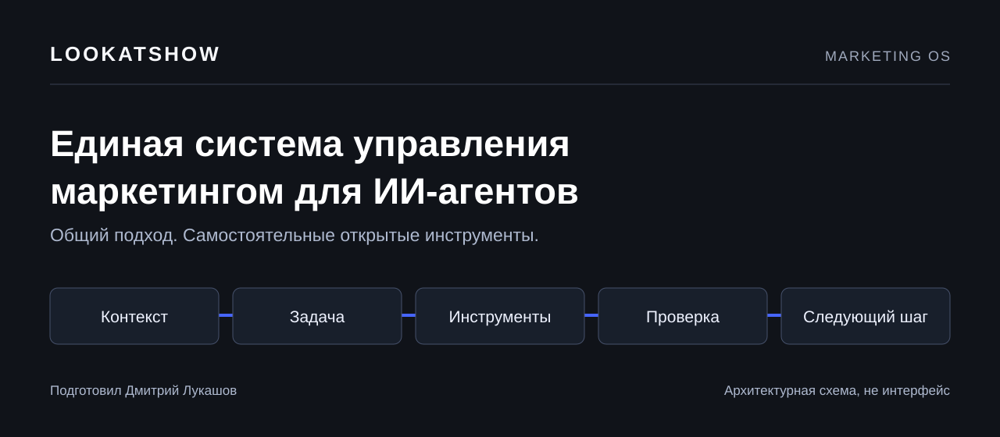

# Lookatshow — единая система управления маркетингом для ИИ-агентов

Поручайте агенту конкретную работу: разобрать рекламные расходы или сравнить условия конкурентов. Lookatshow соединяет такие задачи с контекстом компании, инструментами и проверкой результата. Вы выбираете модель; работа строится вокруг вашего бизнеса.

Этот каталог открытых модулей подготовил **Дмитрий Лукашов**. Начните с одного бесплатного инструмента, который можно проверить на учебных данных, а затем применить к своему процессу.

[Начать с рабочего примера](START-HERE.md) · [Как устроена система](ARCHITECTURE.md) · [Каталог для агента](CATALOG.json) · [English](README.md)

## Что можно использовать сейчас

### Проверить площадки Яндекс Директа: direct-report-audit

Скармливаете локальную CSV/TSV-выгрузку, получаете суммы, CPC/CPA и площадки для ручной проверки с объяснением причин. Повторные строки одной площадки суммируются; нулевая конверсия не превращается в приказ её отключить.

Python 3.9+, стандартная библиотека. Кабинет, API-ключи и покупка ядра не нужны. Команда ничего не меняет в рекламе и не отправляет отчёт в сеть.

[Код и инструкция](https://github.com/ilookatshow-gif/direct-report-audit) · [Скачать v0.1.0](https://github.com/ilookatshow-gif/direct-report-audit/releases/tag/v0.1.0) · [Учебная выгрузка](https://github.com/ilookatshow-gif/direct-report-audit/blob/v0.1.0/examples/synthetic-placements.csv)

В [START-HERE](START-HERE.md) есть точные команды и проверенный результат: пять учебных строк, четыре площадки, два кандидата на ручную проверку. Все показатели в примере выдуманы; это проверка инструмента, не финансовый кейс.

### Сравнить цены, сроки и состав офферов: competitor-offer-radar

Сохраняете условия одного предложения в две разные даты, даёте агенту два разрешённых JSON-снимка. Инструмент показывает изменения заявленной суммы, срока и компонентов с исходными значениями, URL и датами. Он не собирает сайты и не решает за вас, чьё предложение лучше.

[Скачать проверенные исходники ZIP](https://github.com/ilookatshow-gif/competitor-offer-radar/archive/7206178f1f6c7484c6f4463c62fe48d497b398d6.zip) · [Установить через Codex или Claude Code](START-HERE.md#radar-current-source) · [Учебные снимки этой версии](https://github.com/ilookatshow-gif/competitor-offer-radar/tree/7206178f1f6c7484c6f4463c62fe48d497b398d6/examples)

В выдуманном примере сумма выросла на 25%, срок увеличился на 50%, интервью стало одно вместо двух. Отчёт предупреждает: состав изменился, поэтому это не чистое подорожание равнозначного пакета. Python 3.9+, без зависимостей и покупки ядра. В исходниках от 11 октября исправлен вывод кириллицы; установка и учебный запуск проверены в четырёх CI-окружениях Ubuntu, Windows и macOS. [Точные версии и результаты проверки](https://github.com/ilookatshow-gif/competitor-offer-radar/actions/runs/38153820165).

ZIP выше закреплён за commit `7206178`; его можно дать агенту с запросом из START-HERE. Это исправленные исходники, не новый релиз. Исторический [v0.1.0](https://github.com/ilookatshow-gif/competitor-offer-radar/releases/tag/v0.1.0) не перезаписан и не содержит исправления кириллицы. Для новой установки используйте закреплённый ZIP.

В [пошаговом практикуме со скриншотом](https://lookatshow.ru/practice/sravnenie-offerov-konkurentov-ii/?utm_source=github&utm_medium=open_module&utm_campaign=competitor-offer-radar&utm_content=demo) есть команды запуска, исходные JSON-файлы и готовый запрос для агента. Практикум использует закреплённый исправленный архив исходников выше. На скриншоте — отдельная страница просмотра настоящего локального вывода на вымышленных данных, а не встроенный интерфейс модуля.

### Проверить незавершённые дела по сделкам Битрикс24

[`bitrix-read-kit`](https://github.com/ilookatshow-gif/bitrix-read-kit) показывает, у каких видимых сделок в работе не найдено незавершённого CRM-дела. Отдельно отмечает просроченные, запланированные дела, отсутствие срока и неполное чтение. Это проверка записей, не оценка менеджера или доказательство потерянной продажи.

[Скачать ZIP v0.1.0](https://github.com/ilookatshow-gif/bitrix-read-kit/releases/download/v0.1.0/bitrix-read-kit-0.1.0.zip) · [Запрос для Codex или Claude Code](https://github.com/ilookatshow-gif/bitrix-read-kit/blob/v0.1.0/README.ru.md) · [Учебные данные](https://github.com/ilookatshow-gif/bitrix-read-kit/blob/v0.1.0/examples/synthetic-snapshot.json)

Дайте архив своему агенту: пусть установит пакет в новую папку и запустит `doctor` и `demo`. В выдуманном примере пять сделок и три незавершённых дела; неполную выборку нельзя трактовать как отсутствие дела. Python 3.9+, без покупки ядра. Реальная CRM подключается отдельно через ваш приватный webhook; модуль ничего в ней не изменяет.

Установка и учебный запуск прошли [четыре CI-окружения](https://github.com/ilookatshow-gif/bitrix-read-kit/actions/runs/38224428848): Ubuntu, Windows и macOS, 95 тестов в suite (на Windows один POSIX-only тест пропущен). Это проверка конкретной версии, не подтверждение доступа к любому порталу или клиенту ИИ.

В [пошаговом практикуме по Битрикс24](https://lookatshow.ru/practice/bitrix-prosrochennye-dela-ii/?utm_source=github&utm_medium=open_module&utm_campaign=bitrix-read-kit&utm_content=demo) есть готовый запрос для агента, JSON-файлы, точные команды и скриншот настоящего результата на пяти вымышленных сделках. Затем меняем один признак полноты чтения и проверяем, почему пустой неполный ответ не доказывает отсутствие дела. На скриншоте — отдельная страница просмотра сохранённого локального вывода, не интерфейс Битрикс24.

## Один порядок работы для разных агентов

| Шаг | Что нужно получить |
|---|---|
| Контекст | Продукт, задача компании, источники и границы действий |
| Задача | Конкретный вход и критерий готовности |
| Инструменты | Команда или интеграция, подходящая для этой работы |
| Проверка | Сверка ответа с данными, квитанцией или изменённым объектом |
| Следующий шаг | Решение, ответственное лицо и условие повторной проверки |

Открытый модуль решает отдельную задачу. Ядро системы объединяет контекст, настройки и процессы как отдельная поставка; этот репозиторий содержит каталог и инструкции, а не установщик ядра. Подробности разделены в [архитектуре](ARCHITECTURE.md).

## Следующие задачи

В плане развития — инструмент для email и дальнейшие связки процессов. Первый read-only инструмент для Битрикс24 уже доступен выше; появление других задач в плане не означает готовую интеграцию.

## Повторить на своём бизнесе

Если хотите научиться ставить агенту задачи и проверять его работу, начните с [личного обучения](https://lookatshow.ru/executive?utm_source=github&utm_medium=open_module&utm_campaign=catalog&utm_content=readme_ru_learn).

Если нужен исполнитель, [обсудим внедрение одного процесса](https://lookatshow.ru/ai-implementation/?utm_source=github&utm_medium=open_module&utm_campaign=catalog&utm_content=readme_ru_implementation). Разработка, сроки и поддержка обсуждаются отдельно от обучения.

Практические разборы Дмитрия: [Telegram-канал](https://t.me/lookatsoul). Подписка не нужна для работы бесплатных модулей.

## Частые вопросы

### Это работает только с Codex?

Выпущенный инструмент запускается как локальная Python-команда. Для Codex и Claude Code есть готовые prompts и companion skill. Если другой агент умеет запускать команды и читать JSON, он может использовать тот же контракт; конкретную среду сначала проверьте учебным примером. Независимость от модели является принципом архитектуры, а не обещанием проверенной совместимости любого клиента.

### Модуль сам отключит площадки или отправит письма?

Нет. `direct-report-audit` читает выбранную выгрузку и возвращает расчёт. Живые интеграции требуют своих доступов и отдельно выбранных границ действий; установка каталога их не подключает.

### Что придётся купить?

Для опубликованного модуля ничего: он работает самостоятельно, по MIT. Обучение, внедрение, ядро и расходы сторонних сервисов обсуждаются отдельно. Рекламная ссылка не ограничивает права по лицензии.

### Где останутся мои данные?

Локальный анализ не отправляет файл отчёта в сеть. Опциональный `capture` обращается к вашему Битрикс24 за доступными CRM-записями. Облачный агент может видеть переданный ему вход или вывод. Не отдавайте ему закрытые данные без разрешения компании и соблюдения политики провайдера; учебного примера достаточно для первого запуска.

## Лицензия и вклад

Новая документация каталога: [MIT](LICENSE), © 2026 Дмитрий Лукашов. У каждого модуля собственные LICENSE/NOTICE и границы поставки. Если нашли ошибку, приложите версию, команду и небольшой выдуманный пример, который её повторяет. Отчёты клиентов, контакты, пароли и ключи в issues не публикуйте.
